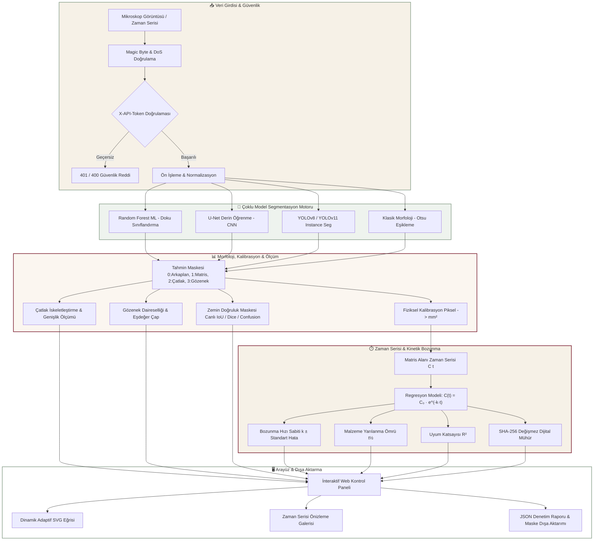
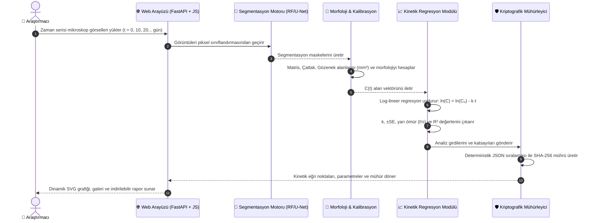

# Mikroskop Bozunma Analizi

> **ML/DL Destekli Mikroskop Segmentasyonu, Morfolojik Geometri ve Kinetik Bozunma Analiz Platformu**

[](https://github.com/cansukalkan)
[](https://github.com/cansukalkan/biyobozunma)
[](pyproject.toml)
[](https://fastapi.tiangolo.com)
[](tests/)
[](docs/security-audit.md)
[](docs/data-license.md)

---

## 🏷️ Anahtar Kelimeler & Konular (Keywords & Topics)

`semantic-segmentation` · `materials-science` · `biodegradation` · `computer-vision` · `crack-detection` · `pore-analysis` · `morphology-analysis` · `kinetics-modeling` · `first-order-decay` · `yolov8` · `unet` · `random-forest` · `fastapi` · `microscopy-analysis` · `tamper-evident` · `docker-hardened` · `crackenpy`

---

## 🔬 Genel Bakış

**Bozunma Analizi**, malzeme ve biyomalzeme bilimi kapsamında mikroskop görüntülerinde oluşan mikro çatlak ve gözenek yapılarını semantik olarak segmente eden, tespit edilen kusurların geometrik morfolojisini çıkaran, alan ölçümlerini optik kalibrasyonla fiziksel birimlere ($mm^2$) dönüştüren ve zaman serisi üzerinden birinci derece üstel kinetik bozunma hızını ($C(t) = C_0 \cdot e^{-k \cdot t}$) hesaplayan uçtan uca bilimsel analiz platformudur.

Platform; **CrackenPy** (Dvorak ve ark., 2024) mikroskop veri seti referans alınarak geliştirilmiş olup, kurumsal düzeyde güvenlik sertleştirmesi (timing-safe token doğrulama, magic byte filtreleme, hız sınırlaması, root olmayan Docker konteyneri) ve özel renk paletine (sage grey, deep burgundy, warm cream) sahip zengin bir web arayüzü sunmaktadır.

---

## 📐 Sistem Mimarisi & İş Akışı (Architecture Diagram)



---

## ⏱️ Kinetik Bozunma Analizi Akışı (Kinetics Pipeline)



---

## ✨ Temel Yetenekler & Bilimsel Çıktılar

### 1. Çoklu Model Segmentasyon Motoru
* **Random Forest (ML):** Piksel seviyesinde doku özelliklerine göre eğitilmiş, ağırlık hash doğrulamalı (%98.8 test doğruluğu) makine öğrenmesi modeli.
* **U-Net (DL):** Karmaşık çatlak ve gözenek morfolojilerini yakalayan biyomedikal evrişimli sinir ağı (CNN) mimarisi.
* **YOLO Instance Segmentation:** Çatlak ve gözenek sınırlarını yüksek hızda çıkaran poligon tabanlı nesne segmentasyonu.
* **Klasik Morfoloji (Otsu & Morfolojik Eşikleme):** Temel referans (baseline) kıyaslama algoritması.

### 2. Çatlak ve Gözenek Morfoloji & Geometri Analitiği
* **Çatlak İskelet Uzunluğu (Skeletonization / Medial Axis):** Çatlakların morfolojik iskeleti çıkarılarak fiziksel boyutu ($\mu m$ veya $mm$) hesaplanır.
* **Ortalama Çatlak Genişliği:** $\text{Alan} / \text{İskelet Uzunluğu}$ oranı ile mikro çatlak kalınlığı belirlenir.
* **Gözenek Daireselliği (Circularity / Form Factor):** $\frac{4\pi \times \text{Alan}}{\text{Çevre}^2}$ formülü ile 0.0 – 1.0 skalasında (1.0 = kusursuz dairesel boşluk) gözenek biçim faktörü ölçülür.
* **Ortalama Eşdeğer Gözenek Çapı:** Gözeneklerin dairesel eşdeğer alan çapları ($\mu m$) raporlanır.

### 3. Fiziksel Kalibrasyon & Alan Ölçümü
* Piksel sayımları optik kalibrasyon faktörüne ($\mu m/\text{px}$) göre otomatik olarak $mm^2$ birimine çevrilir.
* Kalibrasyon durumu `MEASURED` (doğrulanmış fiziksel ölçek) veya `PENDING` (geçici/provisional varsayılan ölçek) olarak şeffaf biçimde etiketlenir.

### 4. Zaman Serisi & Kinetik Bozunma Analitiği
* **Birinci Derece Üstel Bozunma Regresyonu:**
  $$C(t) = C_0 \cdot e^{-k \cdot t}$$
  * $k$: Bozunma hız sabiti ($\text{gün}^{-1}$) ve standart hatası ($\pm \text{SE}$)
  * $C_0$: Başlangıç matris alanı ($mm^2$)
  * $t_{1/2}$: Malzeme yarı ömrü ($\frac{\ln 2}{k}$)
  * $R^2$: Regresyon uyum katsayısı
* **Kriptografik Değişmezlik Mührü (Tamper-Evident SHA-256):** Tüm zaman adımları ve kinetik parametreler deterministik sıralama ile özetlenerek kurumsal denetim izi oluşturulur.
* **Dinamik SVG Eğrisi & Zaman Serisi Galerisi:** Malzemenin zamana bağlı çözünme ve hasar gelişimini mikro ölçekte yansıtan adaptif ölçekli grafik ve görsel galerisi.

### 5. Algoritmik Doğruluk & Kıyaslama Metrikleri
* **Canlı Zemin Doğrulaması (Ground Truth):** Kullanıcı referans maske yüklediğinde piksel piksel doğruluk (Accuracy), Sınıf Bazlı IoU (Jaccard), Dice Katsayısı (F1-score), Kesinlik (Precision), Duyarlılık (Recall) ve Hata Bindirmesi (Confusion Map) canlı hesaplanır.
* **Model Kıyaslama Tablosu:** CrackenPy test kümesinde ölçülen Leave-One-Image-Out çapraz doğrulama sonuçları kullanıcıya sunulur.

---

## 📊 Örnek Model Kıyaslama Tablosu (CrackenPy Test Kümesi)

| Model Mimarisi | Piksel Doğruluğu | Ortalama mIoU | Çatlak Dice | Gözenek Dice | Çıkarım Hızı |
| :--- | :---: | :---: | :---: | :---: | :---: |
| **Random Forest (ML)** | **% 98.8** | **0.774** | **0.867** | **0.781** | ~45 ms |
| **U-Net (Derin Öğrenme)** | % 98.6 | 0.761 | 0.852 | 0.770 | ~85 ms |
| **YOLOv8-Seg (DL)** | % 97.9 | 0.718 | 0.810 | 0.725 | ~22 ms |
| **Klasik Morfoloji (Otsu)**| % 96.2 | 0.620 | 0.710 | 0.635 | ~15 ms |

---

## 🔒 Güvenlik Sertleştirmesi

Proje, OWASP ve kurumsal veri güvenliği standartlarına uygun olarak sıkılaştırılmıştır:

* **Zamanlama Saldırısı Koruması (Timing-Safe Auth):** API anahtarı doğrulaması sabit zamanlı `hmac.compare_digest` ile yapılır; yan kanal saldırıları engellenir.
* **Girdi Temizleme (Magic Byte Validation):** Yalnızca geçerli PNG, JPEG ve TIFF imzaları kabul edilir. Dosya uzantısı manipülasyonu ile gizlenmiş SVG/HTML (XSS) veya ikili kodlar derhal reddedilir.
* **Dekompresyon Bombası (Zip/Pixel Bomb) Koruması:** `MAX_IMAGE_PIXELS` ve `MAX_UPLOAD_BYTES` (20 MB) sınırlarıyla bellek tüketimi (DoS) engellenir.
* **Hız Sınırlaması (Rate Limiting):** IP başına dakikada maksimum 10 istek sınırı (`SlowAPI`).
* **Gizlilik Koruması:** Yüklenen orijinal dosya adları bellekte ve loglarda asla tutulmaz (`UUIDv4` kullanılır).
* **Güvenlik Başlıkları:** Katı CSP (`Content-Security-Policy`), `X-Frame-Options: DENY`, `X-Content-Type-Options: nosniff`.
* **Konteyner İzolasyonu:** Root olmayan `appuser` (UID: 10001), `no-new-privileges: true`, `cap_drop: ["ALL"]`, yerel ağ bağlaması (`127.0.0.1`).

---

## 📁 Proje Dizin Yapısı

```text
biyobozunma/
├── configs/                  # Kalibrasyon ve eğitim konfigürasyonları (YAML)
├── data/
│   └── raw/                  # CrackenPy referans mikroskop görüntüleri ve maskeleri
├── demos/                    # Sprint ilerleme raporları ve benchmark çıktıları
│   └── sprint-5/             # Model doğruluk değerlendirme sonuçları (evaluation.json)
├── docs/                     # Şartname, güvenlik denetimi ve lisans dokümanları
│   ├── security-audit.md     # Güvenlik ve zafiyet tarama raporu
│   ├── data-license.md       # Veri seti lisans bilgileri (BSD-3-Clause)
│   └── spec.md               # Teknik spesifikasyon
├── models/                   # Model ağırlıkları ve SHA-256 doğrulama manifestosu
├── src/bozunma/              # Ana Python kütüphanesi
│   ├── data/                 # Veri yükleme, YOLO format dönüşümü ve sızıntısız bölme
│   ├── evaluate/             # IoU, Dice, Precision, Recall ve model segmenterları
│   ├── kinetics/             # Zaman serisi, üstel uydurma ve SHA-256 kayıt mühürleme
│   ├── measure/              # Alan ölçümü, kalibrasyon ve morfolojik analiz
│   └── web/                  # FastAPI web servisi, kimlik doğrulama ve statik arayüz
│       └── static/           # HTML, CSS (sage/burgundy paleti), Vanilla JS
├── tests/                    # Kapsamlı pytest test paketi (76 test)
├── Dockerfile                # Çok aşamalı, root olmayan güvenli Docker dosyası
├── docker-compose.yml        # Güvenlik bayraklarıyla izole konteyner orkestrasyonu
└── pyproject.toml            # Bağımlılıklar, araç konfigürasyonları (ruff, pytest, mypy)
```

---

## 🚀 Kurulum ve Çalıştırma

### Gereksinimler
* Python 3.11 veya 3.12
* [uv](https://github.com/astral-sh/uv) (önerilir) veya `pip`

### 1. Depoyu Klonlama & Bağımlılıklar

```bash
# GitHub deposunu klonlayın
git clone https://github.com/cansukalkan/biyobozunma.git
cd biyobozunma

# Bağımlılıkları yükleyin
uv sync --all-extras

# Sanal ortamı etkinleştirin (Windows PowerShell)
.venv\Scripts\Activate.ps1
# Linux/macOS: source .venv/bin/activate
```

### 2. Çevre Değişkenleri

```bash
# Windows PowerShell
$env:BOZUNMA_API_TOKEN = "bozunma-secret-2026"
$env:BOZUNMA_ENV = "dev"  # Üretimde 'production' yapınız

# Linux / macOS
export BOZUNMA_API_TOKEN="bozunma-secret-2026"
export BOZUNMA_ENV="dev"
```

### 3. Web Sunucusunu Başlatma

```bash
uvicorn bozunma.web.app:get_app --factory --host 127.0.0.1 --port 8765
```

Arayüze tarayıcınızdan erişin:  
👉 **`http://127.0.0.1:8765/`**

---

## 🐳 Docker ile Çalıştırma

Platform, güvenlik sertleştirmesi yapılmış konteyner içinde tek komutla ayağa kalkar:

```bash
# İmajı derleyin ve başlatın
docker-compose up --build -d

# Logları takip edin
docker-compose logs -f
```

---

## 🧪 Test ve Kalite Güvencesi

Tüm testleri ve statik güvenlik analizlerini çalıştırmak için:

```bash
# 1. Birim, Entegrasyon ve Web Testleri (76 Test)
pytest -v

# 2. Statik Güvenlik Analizi (Bandit)
bandit -r src/

# 3. Bağımlılık Güvenlik Taraması (Pip-Audit)
pip-audit

# 4. Kod Stili ve Linting (Ruff)
ruff check .
```

---

## 👩‍💻 Yazar & İletişim

* **Geliştirici:** Cansu Kalkan
* **GitHub:** [@cansukalkan](https://github.com/cansukalkan)
* **Proje Deposu:** [https://github.com/cansukalkan/biyobozunma](https://github.com/cansukalkan/biyobozunma)

---

## 📜 Lisans ve Atıf

Bu proje **BSD-3-Clause** lisansı ile sunulmaktadır.

### Veri Seti Atfı
Platformda kullanılan mikroskop referans verileri CrackenPy projesine dayanmaktadır:
* **Kaynak:** Dvorak, J. ve ark. (2024). *CrackenPy: Automated Semantic Segmentation of Cracks and Pores in Materials Science*.
* Lisans ve kullanım şartları için [`docs/data-license.md`](docs/data-license.md) dosyasına bakınız.
