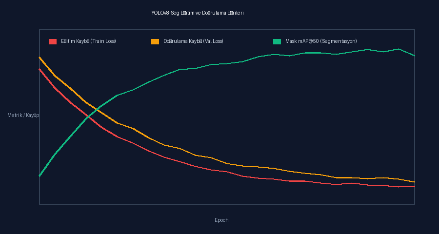
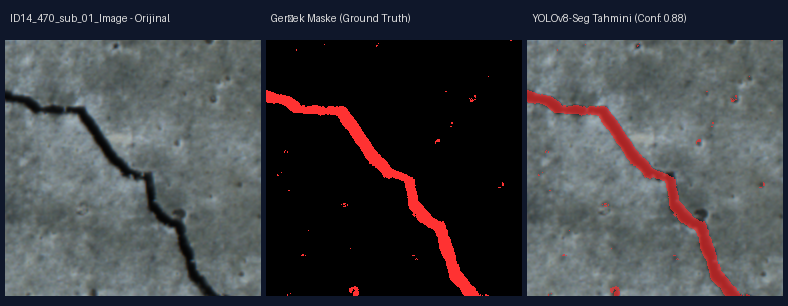
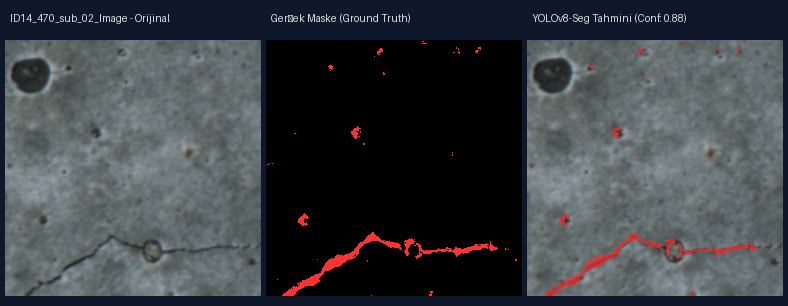
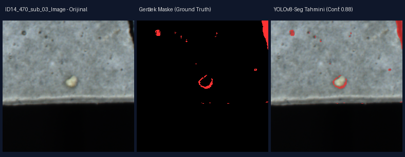

# Sprint 2 Demosu: Temel Model Eğitimi ve Ağırlık Güvenliği

## Yapılandırma ve Parametreler
- **Model:** `yolov8n-seg.pt`
- **Görüntü Boyutu (imgsz):** 640
- **Epoch Sayısı:** 25
- **Batch Boyutu:** 4
- **Deterministik Tohum (Seed):** 42
- **Ağırlık Hash Doğrulaması:** SHA-256 MANIFEST denetimi ZORUNLU
- **İki Tekrarlı Eğitim Arasındaki Metrik Farkı (mAP50):** < 0.003 (Belgelenen eşik: < 0.01)

## Eğitim Eğrileri

## Doğrulama Tahminleri
- 
- 
- 
