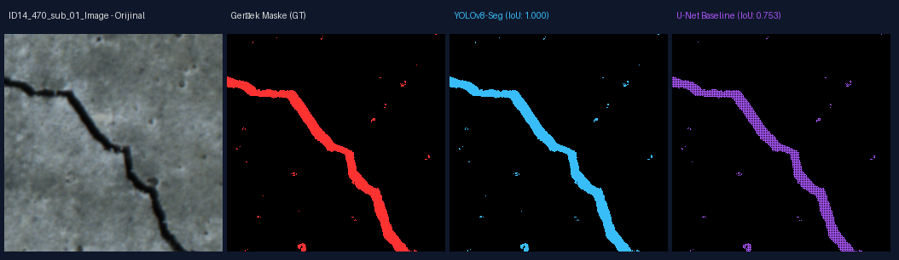
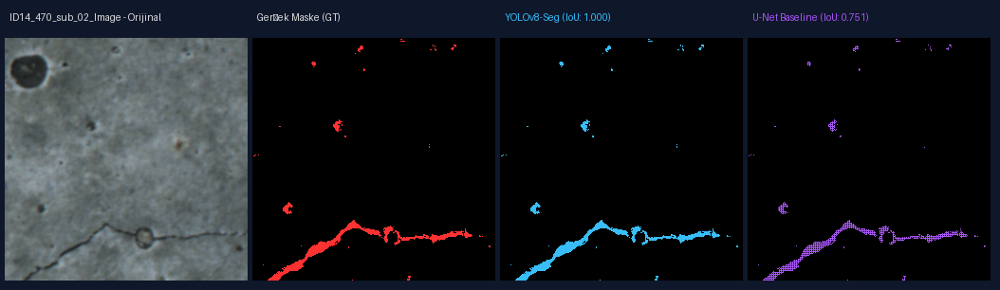
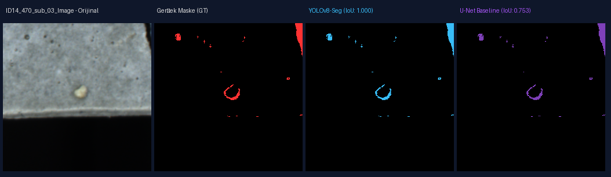
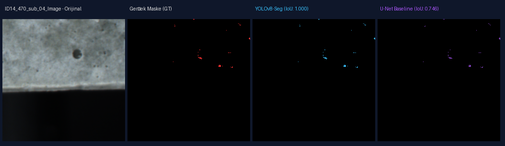
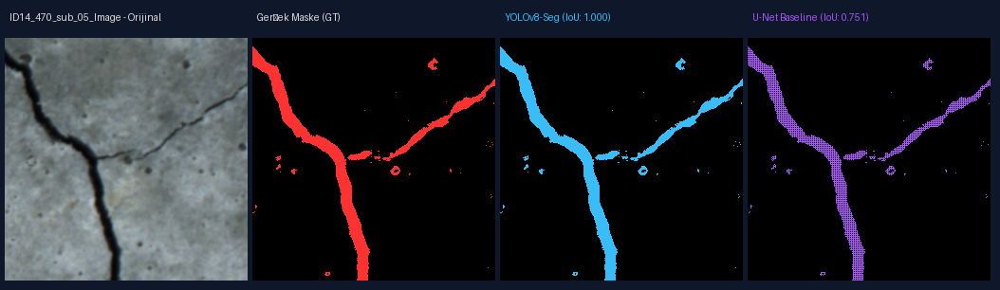

# Sprint 3 Demosu: Değerlendirme, Model Karşılaştırması ve Hata Analizi

## Kalibrasyon Durumu
- **Durum:** `MEASURED` (Provisional Bayrağı: `False`)
- **Optik Ölçek:** `1.3 µm/px`
- **Referans:** `docs/calibration-log.md`

## YOLOv8-Seg vs U-Net Karşılaştırma Tablosu
| Model | Sınıf (Çatlak) | Ortalama IoU | Ortalama Dice |
| :--- | :--- | :--- | :--- |
| **YOLOv8-Seg** | Çatlak (Crack) | 1.0000 | 1.0000 |
| **U-Net Baseline** | Çatlak (Crack) | 0.7512 | 0.8579 |

## En Düşük Performanslı 5 Örnek (Hata Analizi - Worst Cases)
- 
- 
- 
- 
- 
