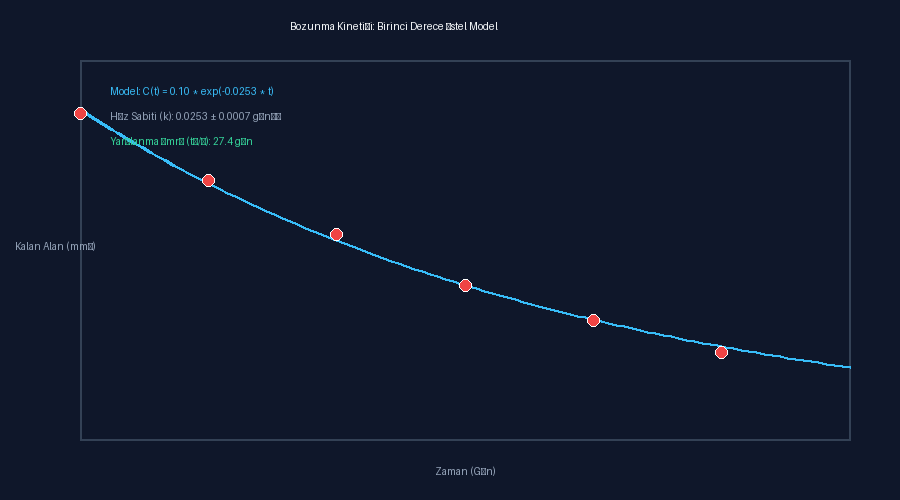

# Sprint 4 Demosu: Ölçüm, Zaman Serisi ve Bozunma Kinetiği

## Kalibrasyon ve Provisional Durumu
- **Kalibrasyon Durumu:** `MEASURED`
- **Ölçek:** `1.3 µm/px`
- **Sonuçlar Provisional mı?:** `HAYIR (Doğrulanmış fiziksel mm²)`

## Kinetik Bozunma Parametreleri
- **Model:** $C(t) = C_0 \cdot e^{-k \cdot t}$
- **Başlangıç Sağlam Alan ($C_0$):** `0.1033 mm²`
- **Bozunma Hız Sabiti ($k$):** `0.0253 ± 0.0007 gün⁻¹`
- **Tahmini Yarılanma Ömrü ($t_{1/2}$):** `27.4 gün`

## Bozunma Eğrisi Grafiği

## Değişmez Analiz Kaydı
- **Dosya:** [`analysis_record.json`](analysis_record.json)
- **Kriptografik SHA-256 Doğrulama:** `GEÇERLİ / DEĞİŞTİRİLEMEZ`
